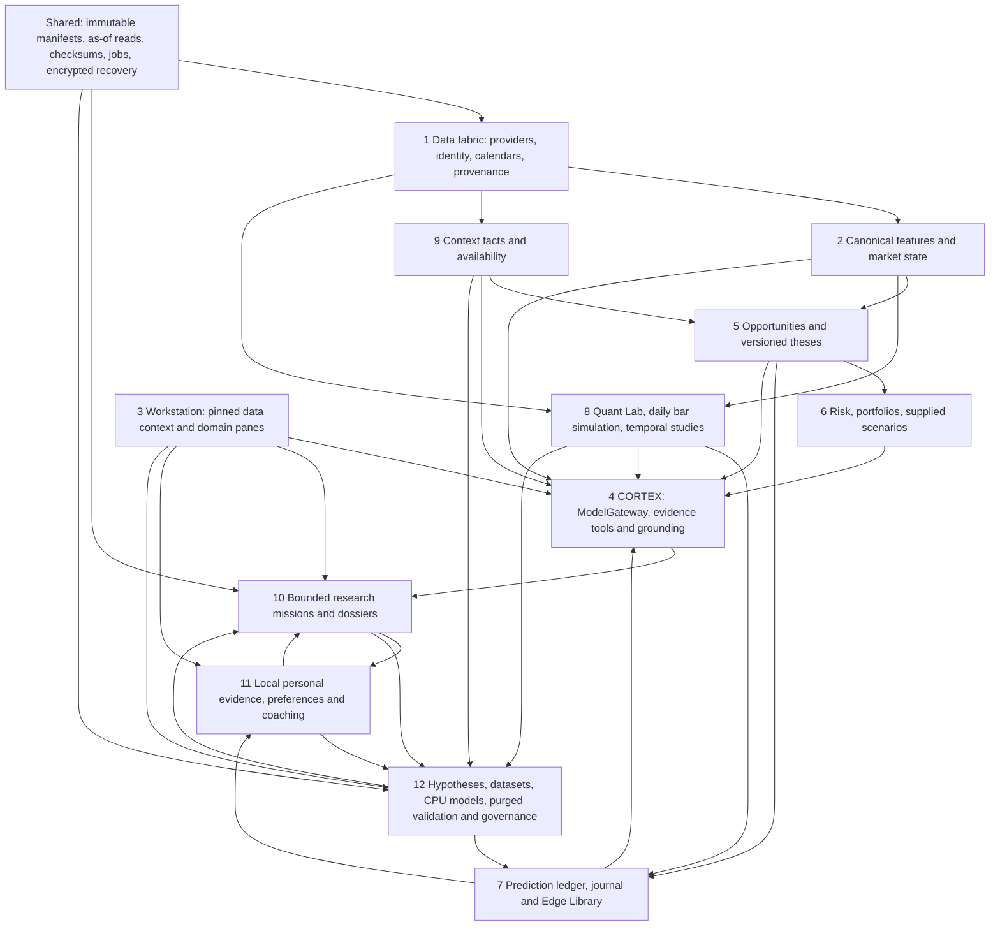

# MARKET CORTEX v1 — Phases 1–12 architecture map

The private modular monolith keeps calculations deterministic and AI research evidence-grounded. FastAPI, strict Pydantic contracts and PostgreSQL compose durable domains; immutable Parquet remains analytical market history. The workstation is Next.js/React/TypeScript. There are no order APIs, broker writes, microservices or mandatory cloud/GPU services.

| Phase | Durable evidence / integration boundary |
|---|---|
| 1 | Typed source envelopes, immutable raw/adjusted distinction, revisions, identity mappings, calendar state, Parquet manifests and as-of visibility |
| 2 | Registered canonical numerical features, cross-asset alignment, freshness/coverage and explicit market-state rules |
| 3 | Loopback workstation/API; pinned manifest and cutoff controls, coverage and lineage |
| 4 | ModelGateway and allowlisted tools; source evidence remains data, numerical claims are grounded, deterministic free fallback |
| 5 | Opportunity candidates, detector evidence, versioned theses and bounded lifecycle transitions |
| 6 | Versioned local research portfolios, risk snapshots, sizing and supplied what-if shocks; no capital deployment |
| 7 | Append-only journals, frozen predictions, delayed evaluations, descriptive learning and hypothesis Edge Library |
| 8 | Registered daily strategies, canonical fill simulator, costs, walk-forward, sensitivity/robustness/Monte Carlo and immutable replay artifacts |
| 9 | Domain-specific contextual facts, revisions, manifests, instrument/contract mappings, recording and publication semantics |
| 10 | Frozen mission scope/budgets, evidence graph, skeptical claims, checkpoints, leases, cancellation, replay and ResearchDossiers |
| 11 | Verified local personal snapshots, explicit preferences, provisional patterns/coaching and owner-controlled memory actions; synthetic evidence excluded from genuine owner history |
| 12 | Registered experimental hypotheses, frozen source/dataset/model manifests, purged nested temporal studies, safe JSON models, negative evidence, exposure ledger, bounded CORTEX extension and human research governance |

## One integrated research workflow

`Trusted data → deterministic features → market/context state → opportunity/thesis → CORTEX review → risk → frozen hypothesis/experiment → training/temporal tests → robustness/uncertainty → skeptic → statistical evidence → Edge link → dossier → replay → owner research decision`.

The machine-readable proof is `docs/quant/PHASE_12_SYSTEM_WORKFLOW.json`. It uses real stored Binance prices and explicitly synthetic pilot portfolio records. It checks canonical record counts before/after and never writes owner-main history. Stale market context and unavailable data can produce wait/insufficient/no-edge outputs throughout this chain.

## Storage and time

PostgreSQL owns transactional/catalog state, journal/thesis/personal revisions, workflow jobs and research artifact metadata/JSON. Parquet owns immutable market/context observations. Derived experiment rows reference observation/input hashes; model metadata is restricted JSON, with no pickle deserialization. Corrections append evidence; recorded artifacts are never silently recomputed as current data.

AS_RECORDED requires actual knowledge timestamps. Price HISTORICAL_RECONSTRUCTION is explicitly assumed and distinct from recorded replay. Context always uses actual publication/ingestion/recording/manifest knowledge. Raw data is never converted into adjusted history implicitly. Indian/US calendars and mappings require verified source-specific evidence before operational use.

## Boundaries and next operational work

This release completes the original architectural phases. Validated daily research is primarily the five-pair Binance pilot. Owner deployment, genuinely unseen prospective validation, owner habit sufficiency, authenticated India/US validation and missing advanced sources remain separate operational work. No phase tag establishes profitability, investment suitability or trading authorization.
