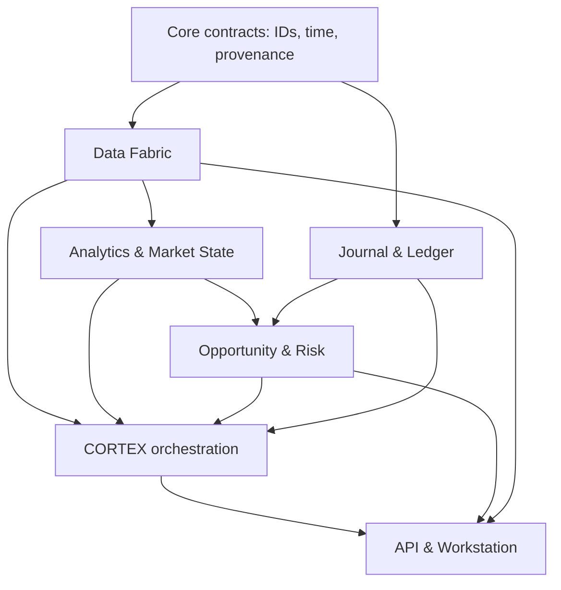

# MARKET CORTEX
## Project Constitution and Phase 0 Architecture Blueprint

**Status:** Proposed baseline for architecture review  
**Version:** 0.1 · 26 September 2026  
**Owner:** Faris Ruknuddin  
**Purpose:** A private, local-first market research and decision-support system. Trade execution occurs elsewhere.

> **North star:** Help the owner notice what matters, test a trade idea against evidence and risk, remember the decision as it was made, and learn from the outcome. A valid answer is “no edge,” “data unavailable,” or “wait.”

## 1. Executive decisions

1. **Build a modular monolith first.** One Python application owns data ingestion, deterministic analytics, research orchestration, and the API; a TypeScript web application owns the interface. Internal modules communicate through typed interfaces and persisted jobs. Deployable services are an option after measured need.
2. **Choose a narrow vertical slice before broad coverage.** The first usable product supports a deliberately small, named universe spanning Indian equities, US equities, and crypto spot at daily-bar resolution, plus a small cross-market context set. Coverage is only “supported” when history, identifiers, adjustment behavior, calendars, freshness, and provider rights pass the same acceptance checks. Real-time feeds are a later capability.
3. **Treat market data as evidence with time and lineage.** Store raw observations, normalized facts, correction history, source identifiers, when each value was available, and dataset versions. Never overwrite the evidence used by a historical decision.
4. **Keep calculation and narration separate.** Deterministic code computes indicators, return distributions, risk, and backtest results. The language model selects authorized tools, explains results, states uncertainty, and cites internal observations. The model is not the source of a numerical result.
5. **Make learning measurable.** Journal entries and timestamped prediction records are immutable in substance; corrections are appended. Learning initially means retrieval and review, then statistical evaluation, then gated model experiments. No autonomous alteration of core logic or live trade execution.
6. **Earn new infrastructure.** PostgreSQL and Parquet/DuckDB are initial storage candidates; an in-process job queue or database-backed worker is enough at first. Redis, dedicated time-series storage, event brokers, workflow engines, vector databases, and Rust are conditional additions.

## 2. Constitution

### Mission and boundaries

**In scope:** local market data and research; charting and screening; cross-market context; thesis construction and challenge; deterministic risk research; user-entered and imported portfolio/journal records; paper decisions; reproducible backtests; AI-assisted explanation; prediction evaluation.

**Out of scope for the foundational product:** placing or routing orders; custody; fully autonomous capital allocation; guaranteed forecasting; a universal institutional-flow detector; unrestricted scraping; replicating every chart feature; claims of real-time awareness from delayed data. If execution is ever considered, it requires a separate architecture and explicit decision.

The application is personal, but data rights, attribution, request limits, credential security, and permitted retention still affect what it can reliably ingest. A private installation does not make every data source technically or contractually available. NSE publishes distinct data products and a data-usage policy; availability and pricing must be checked per selected provider and feed. [NSE policy](https://www.nseindia.com/static/market-data/nse-data-policy), [NSE real-time products](https://www.nseindia.com/static/market-data/real-time-data-subscription).

### Non-negotiable invariants

- **No silent freshness claims.** Every displayed observation and AI claim has an observed/event time, ingestion time, availability time where known, provider, state, and age. The UI explicitly labels stale, delayed, estimated, revised, unavailable, or unknown data.
- **No future information in historical research.** Backtests and historical analogues read only information known by the simulated decision time, including the correct security universe, corporate actions, filings, and macro vintages.
- **No fabricated precision.** An evidence score is an explanation aid; it is not a win probability. Probabilities require out-of-sample calibration with adequate sample sizes.
- **No untraceable answer.** A material assertion links to tool outputs, observations, records, or a clearly marked interpretation; unsupported model text cannot be promoted to evidence.
- **No mutable past.** Past theses, predictions, dataset manifests, strategy runs, and outcomes remain reconstructible. Amendments are append-only and attributable.
- **No compulsory trade.** The system can decline to rank a candidate or advise waiting when quality, coverage, or evidence is insufficient.
- **No performance claim without baseline.** Show costs, assumptions, uncertainty, sample size, benchmarks, and out-of-sample periods.
- **Local ownership.** Structured data, artifacts, journal, and configuration can be backed up and exported in documented formats.

### Success measures

Start with operational measures: valid daily coverage of the chosen universe, pipeline completeness, time to detect stale sources, reproducibility of a thesis snapshot, median dashboard response time, and the share of AI numerical claims grounded in a tool result. Later measure decision outcomes by strategy and regime against an owner-defined baseline, with confidence intervals and multiple-testing awareness. Avoid “more alerts” as a success measure.

## 3. Assumptions challenged and missing capabilities

| Assumption in vision | Correction and architectural response |
| --- | --- |
| “All assets” can share one universal schema. | Share a compact identity and provenance envelope; use asset-specific contracts for derivatives, equities, macro, and order books. Avoid a giant nullable table. |
| Market timestamps are enough. | Track **event time**, provider publication time if exposed, ingestion time, effective time, and **first-known/available time**. They answer different replay questions. |
| A ticker uniquely identifies an asset. | Symbols are venue- and time-dependent. Use internal immutable instrument IDs and time-bounded provider-symbol mappings; include contract expiry, strike, right, multiplier, currency, chain/network when applicable. |
| “One score” can compare everything. | Separate detector confidence, evidence coverage, data quality, and expected risk/reward. Ranking is strategy- and universe-specific. |
| A history of winning ideas proves learning. | Require a complete decision ledger, including rejected and no-trade ideas, selection rules, outcomes, benchmark, and exposure. Otherwise feedback is selected after the fact. |
| More agents make the brain smarter. | Begin with one orchestrator and explicit analyst/skeptic/risk passes. Add agents only if tests show better grounded outcomes at tolerable latency and cost. |
| Cheap/free data equals complete data. | Create a source coverage matrix for each country and asset class: EOD, intraday, depth, corporate actions, fundamentals, derivatives, history, limits, rights, and cost. Unsupported cells remain visible. |
| Local-first means offline market intelligence. | Local research can run on cached snapshots; new observations need a source. Display the last successful refresh and do not infer current conditions from an old cache. |
| A backtest is just an indicator loop. | Need historical constituents, holidays, session boundaries, halts, delistings, action-adjustment policy, publication lag, fees, spread/slippage, and reproducible runs. |

Additional foundational capabilities: instrument master and corporate-action service; market calendars/time zones; currency and unit conventions; source entitlements and retention metadata; ingestion reconciliation; provenance/audit APIs; as-of queries; backup/restore drills; data and model cost budgets; a “coverage and limitations” view; alert fatigue controls; and an owner-controlled correction workflow.

## 4. Domain map and ownership

| Domain / engine | Owns | Does not own |
| --- | --- | --- |
| **Market Data Fabric** | Provider adapters, instrument master, ingestion, raw storage, validation, normalization, source health, corporate actions, calendars | Trade interpretations |
| **Market State Engine** | Versioned regime features, breadth and cross-market state snapshots with evidence | Provider access or trade decisions |
| **Research & Analytics** | Deterministic indicators, fundamental/event features, historical queries, correlations, backtests and later analogues | AI prose or personal preference |
| **Opportunity Engine** | Strategy-specific detection, candidate evidence and rejection reasons | Portfolio authorization or universal “buy” signal |
| **Decision & Risk** | Thesis lifecycle, scenarios, sizing research, portfolio exposure and risk calculations | Broker orders |
| **CORTEX AI** | Tool orchestration, context, contradiction, synthesis, citations and uncertainty | Calculation of canonical statistics, direct database writes outside approved commands |
| **Learning & Performance** | Journal, prediction ledger, evaluation, edge library, model and strategy experiments | Unreviewed mutation of production strategies |
| **Workstation** | Read models, navigation, charts, input forms, freshness badges, explainability and alert review | Independent financial calculations |

Each domain publishes versioned contracts and depends inward on shared IDs, time, provenance, and interfaces. Cross-domain orchestration lives in an application layer, not in provider adapters or UI components. The seven engines are **module boundaries**, not seven required processes.

### Module dependency graph

The diagram shows conceptual dependencies. The UI reads versioned application APIs; it never reads storage tables directly. Journal and market data are peers so owner records do not inherit a data-provider lifecycle.

## 5. Canonical market model and contracts

### Core identity and time

`Instrument` has `instrument_id` (immutable UUID), `asset_class`, `instrument_kind`, `primary_venue_id`, `trading_currency`, `price_unit`, `quantity_unit`, `tick_size`, `lot_size`, `listing_status`, `valid_from/to`, and optional underlying relationship. `IdentifierMapping` connects provider, venue, symbol, ISIN/CUSIP/FIGI or chain/contract identifiers as applicable, with validity interval and resolution confidence. `ContractSpecification` covers futures/options/perpetuals: underlying, expiry, settlement, strike, put/call, multiplier, margin/quote conventions, funding schedule. `TradingCalendar` names the exchange time zone, sessions, holidays and exceptions. Equity listings and crypto pairs are distinct instruments; a company/asset entity can link several listings.

All observations carry a common **ObservationEnvelope**:

| Field group | Minimum contract |
| --- | --- |
| Identity | `observation_id`, `instrument_id` or `series_id`, `venue_id`, `provider_id`, `provider_record_id`, `schema_version` |
| Time | `event_at`, `published_at?`, `available_at`, `ingested_at`, `effective_from/to?`, provider time-zone/precision, `is_final` |
| Quality | `quality_state` (`valid`, `suspect`, `quarantined`, `corrected`), `missing_reason?`, `freshness_policy_id`, `validation_codes[]` |
| Provenance | `source_uri_or_ref`, `source_batch_id`, `raw_content_hash`, `normalizer_version`, `license_policy_id`, `supersedes_observation_id?` |
| Semantics | `currency`, `unit`, adjustment basis and revision/vintage where applicable |

`available_at` is the first time MARKET CORTEX could have used the record, or a conservative source-publication proxy if exact arrival is unknown; record which interpretation is used. Preserve both raw source bytes (when permitted) and the normalized value. Corrected records point to prior versions; an as-of query chooses the version known at its cutoff. A dashboard “freshness” label is derived from asset/feed/session policy, never from a global number of minutes.

### Typed observations

| Contract | Distinct required fields and cautions |
| --- | --- |
| `Trade`, `Quote`, `OrderBookUpdate` | Price/size; bid/ask; sequence, side, level/snapshot marker for book updates. Gaps require resnapshot and quality marking. |
| `Bar` | Interval, session, OHLCV, trade count if supplied, source aggregation method, final/provisional flag; **raw** and adjusted series are separate derived views. |
| `FundingUpdate`, `OpenInterestUpdate`, `Liquidation` | Contract ID, venue, timestamp, funding period/rate, OI unit and currency, liquidation side/size/source limitations. |
| `OptionChainSnapshot` | Snapshot time and members keyed by contract, bid/ask/OI/IV when supplied, underlying mark and convention; Greeks identify calculator and input versions. |
| `CorporateAction` | Type, announcement/record/ex/pay/effective dates, adjustment factor and revision; do not apply newly known actions to an earlier as-of screen. |
| `EconomicEvent` | Release schedule, actual/consensus/prior with publication timestamps and revisions/vintages. |
| `NewsEvent` | Publisher, published/updated/first-seen times, headline/body reference, entity links, deduplication group and redistribution rights. |
| `FundamentalFact` | Entity, metric, period, filing/publication date, units/currency, amendment and taxonomy mapping. |

No field is filled with zero to mean missing. Monetary and quantity types preserve decimal precision; display rounding never changes stored values. UTC is canonical for instants, while exchange-local session dates and time zones are stored separately. Corporate-action adjustments, FX conversions, total-return calculations and index methodologies are named transformations with versioned inputs.

### API and event envelopes

External API resources use `/api/v1/...`; breaking semantics require `/v2` or explicit contract migration. Internal events have `event_id`, `event_type`, `schema_version`, `occurred_at`, `recorded_at`, `correlation_id`, `aggregate_id`, `idempotency_key`, and source observation or job references. Evolve by adding optional fields, then migrate consumers; never silently redefine a field. Example events: `DataBatchAccepted`, `ObservationCorrected`, `MarketStateComputed`, `CandidateDetected`, `ThesisAmended`, `PredictionDue`, `EvaluationCompleted`. They are facts of completed work, not a second mutable truth store.

## 6. Data, storage, provider and event architecture

### Ingestion lifecycle

`Provider request → immutable source batch → parse → identity resolution → schema/unit/time validation → deduplicate/reconcile → quarantine or accept → normalize → materialized views/features → freshness and lineage report.` Backfills and live ingestion share the same contracts. Each batch has counts, requested range, source response hash, failures, retries, gaps, and code versions. A corrected source generates a new batch and an explicit replacement link. Rate-limit per provider, back off on errors, and never infer missing candles to look like observed prices.

Define a **ProviderCapability** manifest: asset classes, venues, frequency, coverage start/end, refresh and latency class, adjustment behavior, historical revisions, supported fields, rate limits, cost, permitted storage/display, and test status. `MarketDataProvider`, `NewsProvider`, `FundamentalProvider`, `MacroProvider`, and later `OnChainProvider` expose typed fetch/stream calls and capability metadata. Provider-specific formats stay in adapters. If two providers disagree, retain both; reconciliation policy can choose a canonical display source and surface conflicts.

### Storage responsibilities

| Store | First implementation | Contents and rule | Upgrade trigger |
| --- | --- | --- | --- |
| Transactional | PostgreSQL | Instrument master, provider mappings, configurations, job metadata, journal, theses, prediction ledger, versions, outbox | Remains authority for these records |
| Analytical | Partitioned Parquet on local disk; DuckDB/Polars for queries | Raw/normalized historical bars, features, snapshots and backtest inputs; manifests and checksums | A measured query/ingestion ceiling or concurrent workload warrants a dedicated time-series service |
| Object/artifact | Local content-addressed directory | Permitted raw responses, screenshots, reports, run outputs; DB stores references and hashes | Remote object store if multi-machine operation or backup needs it |
| Search | PostgreSQL full-text and metadata filters | Notes, journal, theses, source references | Dedicated search when retrieval quality/volume justifies it |
| Semantic | Initially optional adapter; can begin with local embeddings in a supported DB extension | Embeddings of carefully selected research text, never canonical numeric data | Dedicated vector store if recall/scale evidence warrants it |
| Cache | In-process bounded cache | Expensive read models with explicit dataset/version/freshness keys | Redis if multiple processes or measured cache pressure justify it |

PostgreSQL provides declarative partitioning when transactional table sizes require it, while DuckDB reads and writes Parquet and can push filters/projections into scans. These capabilities support the split between small mutable records and larger analytical history; they do not guarantee that the first storage layout will meet every future workload. [PostgreSQL partitioning](https://www.postgresql.org/docs/current/ddl-partitioning.html), [DuckDB Parquet](https://duckdb.org/docs/stable/data/parquet/overview).

### Events and jobs

Phase 1 uses a durable database-backed job table plus transactional outbox, a single worker, idempotent handlers, bounded retries, dead-letter state, and replay commands. The **EventBus** interface can later use NATS JetStream; the **WorkflowEngine** interface can later use a durable workflow product if jobs become multi-day, highly branched, or hard to recover. Consumers assume duplicate delivery and may reorder within documented bounds. Never rely on a broker alone to prove an external provider record was committed. Scheduled market refreshes honor venue calendars and source publication schedules.

### Source feasibility gate

Before Phase 1 implementation, fill a source matrix for the initial universe and verify: accessible endpoints, data terms, historical depth, timestamp/adjustment semantics, quotas, and cost. For US fundamentals, SEC EDGAR exposes submissions and XBRL APIs with fair-access requirements; for macro replay, FRED/ALFRED exposes vintage dates and vintage observations. Neither solves the whole data layer. [SEC APIs](https://www.sec.gov/search-filings/edgar-application-programming-interfaces), [SEC fair access](https://www.sec.gov/search-filings/edgar-search-assistance/accessing-edgar-data), [FRED vintages](https://fred.stlouisfed.org/docs/api/fred/series_vintagedates.html), [FRED observations](https://fred.stlouisfed.org/docs/api/fred/series_observations.html).

## 7. Analytics, market state, opportunity and risk

**Analytics library:** Pure, tested functions on typed, versioned input series; parameter definitions, warm-up windows, missing-data policy, sampling/session rules, adjustment convention, and output units are explicit. A feature result records calculation version and input manifest. Cross-market comparisons align *availability times*, trading sessions, FX, and sampling frequencies. Correlation displays window, method, observations, missingness, and stability. Avoid inference from one synchronized chart alone.

**MarketStateSnapshot** is a vector, not a single mood: trend, volatility, liquidity, risk appetite, breadth, momentum, correlation, sector leadership and macro context. Each dimension stores scope/universe, timeframe, model/rule version, feature references, value or category, coverage, uncertainty, freshness, and `unknown` reason. A regime classifier is first a transparent deterministic baseline; later ML must beat that baseline on chronological holdouts. An overall narrative may summarize dimensions but cannot erase disagreement.

**OpportunityDetector** has a named strategy, eligible universe, timeframe, preconditions, feature definitions, threshold version, exclusion rules, and evaluation protocol. Output `Candidate` contains setup evidence, counterevidence, data coverage, invalidation hypothesis, rank within that detector/universe, detected_at and expiry. “No edge” and rejected candidates are retained for denominator and drift analysis. Normalize detector scores only within a calibrated comparison cohort; never compare a breakout score directly to a mean-reversion score.

**TradeThesis** is a versioned object with owner/source, instrument, horizon, setup and strategy version, market-state reference, supporting and contradicting evidence, entry *area* and conditions, invalidation and stop method, target/scenarios, cost assumptions, portfolio interactions, event risk, data snapshot, evidence-strength rubric, unknowns, and review schedule. `reward/risk` is computed from explicit price, size, cost, and scenario assumptions. Status transitions are recorded: `Watching → Developing → Awaiting Confirmation → Valid`, with branches to `No Edge`, `Event Risk`, `Avoid`, or `Invalidated`; a later change creates a new thesis revision, never rewrites the past. A thesis may exist without an actionable entry.

**Risk engine** accepts an owner-entered portfolio snapshot and scenarios; it computes position exposure, position sizing research, portfolio heat, currency/sector/asset and factor exposures where data permits, correlated bets, event concentration, drawdown and stress estimates. Every result names valuation time, base currency, FX source, holdings completeness, exposure model, and estimation limits. A missing holding or stale quote makes portfolio-level conclusions incomplete. Risk flags are hypotheses for review, not authority to place orders.

## 8. CORTEX brain, tools and memory

### Execution path

`Request → intent and permission policy → as-of context assembly → plan → typed read-only tool calls → evidence graph → skeptical pass → risk pass if material → grounded synthesis → trace/evaluation.` A research run has an ID, user query, tool/schema/model versions, bounded time/cost budget, data cutoff, retrieved source references, outputs, and error status. The orchestrator can decline when evidence quality is inadequate. Time-sensitive answers report the exact cutoff and coverage.

The **ModelGateway** chooses models by task, privacy rule, latency, and budget through a `ModelProvider`; embeddings and reranking have their own interfaces. Tool calls use versioned JSON schemas and strict validation; no arbitrary SQL, shell, file mutation, network browsing, or self-generated tool invocation without a registered capability. Tool results include provenance and error/partial states. A deterministic service computes every indicator, Greek, correlation, backtest and portfolio statistic. The answer formatter maps each numerical claim to result IDs and distinguishes observation, calculation, estimate, interpretation, and unknown.

The first tool set should be small and useful: `resolve_instrument`, `get_asset_snapshot`, `get_market_state`, `get_event_calendar`, `run_screener`, `calculate_portfolio_risk`, `search_trade_journal`, `save_thesis_draft`, and `challenge_thesis`. Build `run_backtest`, options/derivatives, historical analogues and simulations only after their underlying data passes quality gates. `save_thesis_draft` is a controlled command requiring explicit user intent; research tools are read-only. MCP-compatible exposure is an adapter choice, not the internal domain model.

### Memory contracts

| Memory | Backing record and retention rule |
| --- | --- |
| Working | Current run context, short lived, bounded by time/token budget |
| Episodic | Timestamped research runs and decisions, immutable references with retention policy |
| Semantic | Extracted concepts and entity links with source/version and confidence |
| Procedural | Owner-approved rules, prompts, strategy definitions and versions |
| Market | Historical observations and state snapshots; queries require as-of cutoffs |
| Strategy | Runs, parameters, eligible universes and evaluation results |
| Personal | Owner-stated preferences and constraints; editable with explicit provenance |
| Failure | Reviewed data, tool, reasoning and strategy failures with corrective actions |
| Prediction | Immutable prediction record, maturity criteria, evaluation and amendments |

Retrieval first filters by instrument, time, strategy and permission; then lexical search; semantic similarity is an optional reranking signal. Every retrieved item retains its source and timestamp. Summaries are derived caches and can be rebuilt. Conflict handling displays competing records rather than allowing a recent summary to silently replace an original decision.

### AI quality and learning

Use a small, versioned evaluation set of real user questions and intentionally difficult cases: stale quotes, ticker reuse, split adjustments, macro revisions, contradictory indicators, missing holdings, and tempting but unsupported “smart money” claims. Score factual grounding, numerical traceability, contradiction coverage, abstention, time accuracy, latency and cost. Inspect failures and update prompts/tools under version control. Retrieval success is not a prediction edge.

## 9. Journal, prediction ledger and adaptive learning

`JournalEntry` records idea/decision/trade category, timestamp, instrument, strategy, regime snapshot, thesis revision, entry/exit and fees if manually imported, screenshots/artifacts, emotions and rule adherence. Separate **idea time**, **decision time**, **execution time**, and **review time**. The app cannot assume a proposed order was filled. Performance statistics report sample size, R multiple definition, censored/open trades, fees, and whether records are complete. Capture rejected opportunities and no-trade decisions when feasible to measure selection bias.

`PredictionRecord` freezes an unambiguous event definition, reference price or state, horizon/deadline, outcome metric, direction/range, invalidation, stated probability **only if calibrated** (otherwise qualitative evidence), model/prompt/tool/data versions, timestamp and evidence snapshot. At maturity, an independent evaluator adds outcome, missing-data state, scoring rule and evaluator version. No retroactive deletion of wrong calls; append correction records. Evaluate stratified by regime, strategy, horizon and confidence band. If sample size is low, report descriptive results instead of declaring skill.

Learning ladder: (1) memory and owner feedback; (2) descriptive statistics and rule reviews; (3) out-of-sample candidate ranking or regime models; (4) personal models after sufficient and representative observations. Champion/challenger runs use frozen datasets, chronological splits with purge/embargo where labels overlap, cost-aware metrics, calibration, drift checks and rollback. Any proposal to change approved logic produces a diff, rationale and evaluation report for owner review.

## 10. Historical analogues and quant research

An `AnalogueQuery` fixes decision time, eligible historical universe, feature vector, lookback, scaling and similarity weights, feature availability lags, filters and exclusion window. Retrieve nearest prior states, then report number of matches, distance distribution, dates/regimes, forward return, maximum favorable/adverse excursion, volatility/correlation evolution, and sensitivity to distance/feature choices. Overlapping matches are clustered or down-weighted. Hold out recent periods and compare to unconditional and regime-conditioned baselines; superficial visual resemblance is not evidence.

Backtests consume an immutable `ResearchRunManifest`: strategy and code version, instruments and membership as of each date, source batches, adjustment/FX policies, calendar, parameters, costs, seed, feature versions, and environment. Distinguish research, validation, and untouched test intervals. Model exchange rules and execution assumptions per market; a crypto 24/7 bar cannot be treated as an NSE cash-market bar. Run reproducibility, look-ahead, survivorship and leakage checks before publishing a performance chart. Quant lab and replay arrive after the data foundation, not during the first dashboard release.

## 11. Frontend information architecture

1. **Home / Market Brief:** state by market, changes since last view, unusual conditions, data-health banner, watchlist, upcoming events, risks and “worth investigating” queue; every tile links to evidence.
2. **Asset Workspace:** chart and source/adjustment toggles; structure, relative strength, fundamentals/news/events where covered; thesis, scenario, historical comparison and journal history in progressive panels.
3. **Explore:** named-universe screeners, saved criteria, candidate explanations and rejected cases; no unlabeled cross-strategy leaderboard.
4. **CORTEX Research:** question, tool trace, source timestamps, pro/con evidence, uncertainty, time/cost budget, saved draft and challenge action.
5. **Risk & Portfolio:** manually entered/imported holdings, valuation cutoffs, correlated exposures, scenarios and missing-data warnings.
6. **Journal & Edge Library:** decisions, imported executions, reviews, strategy notes, prediction ledger and outcome evaluation.
7. **Quant Lab:** datasets, strategy definitions, reproducible runs, diagnostics and replay; initially hidden until Phase 8.
8. **System Health:** provider coverage, last refresh, quarantined batches, jobs, storage, cost, backups, source permissions and versions.

Use a calm, information-dense layout with responsive charts and keyboard search. The app distinguishes “market closed,” “source delayed,” and “pipeline failed.” Visible badges link to detailed provenance. AI prose never substitutes for the underlying chart, data table, or test report.

## 12. Security, privacy, testing and observability

**Security:** bind local services to loopback by default; authenticate even a single-owner interface if exposed over a network; deny broad tool privileges; store API keys in OS keychain or injected secret store, never source control or logs; encrypt backups or sensitive journal archives; separate provider credentials; document outbound AI data policy and allow disabling cloud inference per run. Keep dependency updates, backups, restore tests, checksum verification and a minimal audit trail. User-generated content and provider news are untrusted inputs to the LLM; retrieved text cannot authorize tools or change instructions.

**Testing pyramid:** contract fixtures for each provider; parser/normalizer and schema migration tests; instrument identity and calendar edge cases; data-quality invariants (OHLC consistency, duplicates, gaps, outliers, monotonic sequence where promised); deterministic analytics property tests on known series; point-in-time replay tests that intentionally introduce revised macro data and later filings; strategy leakage and cost sensitivity tests; API and permission tests; grounded-answer evaluations; end-to-end smoke tests on a tiny frozen fixture. Add a new suite only where a failure mode justifies it.

**Observability:** structured logs with run/batch/correlation IDs, job retries and dead letters, data latency by source and venue session, missing/invalid counts, provider cost/quota, dashboard latency, tool errors, AI answer grounding and abstentions, model cost, backup age, and disk usage. Alerts distinguish warning from failure and are quiet outside relevant sessions. Keep local dashboards and a machine-readable health endpoint.

**Versioning and change control:** Git tags for releases, semantic API versions, explicit DB migrations, schema registry in source control, data manifests with hashes, feature and strategy versions, model/prompt/tool versions, architecture decision records (ADRs), and a changelog. A breaking change includes migration, compatibility tests and rollback instructions. Document privacy and retention for journal and raw source data.

## 13. Technology choices and decision records

Selection rubric: **correctness and point-in-time support first**, then local operability, open export formats, developer productivity, performance under a measured workload, ecosystem health, observability, security, and replacement cost. Decide by small benchmark or spike against concrete targets, not a claim of future-proofing. The following are architecture choices, not permanent vendor commitments.

| ADR | Current choice and why | Alternative and why deferred | Reconsider when |
| --- | --- | --- | --- |
| 001 Deployment | Modular Python backend + TypeScript/React web UI. Strong analytics ecosystem and clear UI separation. | Microservices add operational and consistency overhead to a one-owner installation. | Independent scaling, team ownership or isolation needs become measurable. |
| 002 API | FastAPI with typed request/response schemas and generated OpenAPI; versioned domain contracts outside route handlers. | GraphQL adds schema and caching complexity for a bounded workstation. | Client query flexibility demonstrably reduces complexity. |
| 003 Transactional store | PostgreSQL for integrity, migrations, journals, identity and outbox. | SQLite is easier to install but concurrency and operational shape may constrain growing workers; revisit for a lightweight offline edition. | Installation burden dominates or PostgreSQL cannot meet measured needs. |
| 004 Analytical history | Parquet partitions + DuckDB/Polars. Portable, inspectable, efficient local research. | Dedicated time-series DB is extra operations before query-load evidence. | Representative query/ingestion benchmarks fail defined latency or concurrency targets. |
| 005 Events | DB jobs/outbox and one worker. Durable enough for first pipelines and simpler recovery. | NATS/Temporal bring useful semantics with added infrastructure. | Repeated failures across long workflows, throughput or service separation justify them. |
| 006 AI | ModelGateway and typed tool registry; one orchestration loop with skeptic/risk passes. | Fixed model or free-running agent swarm obscures provenance and cost. | Evaluation proves a specialized agent/model materially improves results. |
| 007 Retrieval | Structured filters + full-text first, embeddings optional. | A vector DB from day one adds indexing and versioning burden. | Measured recall on a labeled retrieval set remains inadequate. |
| 008 Calculations | Python deterministic analytics with optimized columnar libraries. | Rust and GPU code complicate builds before profiling. | Profiling identifies stable hot paths with material user-visible gains. |
| 009 Charting | Replaceable chart component behind a data/view contract. | Tight coupling to a proprietary chart model limits later swaps. | A chosen library's features or license cease to fit needs. |
| 010 Local/cloud | Local data and artifacts, optional cloud model calls with explicit privacy controls. | Fully local models may initially miss quality/latency targets. | Local alternatives pass the same evaluation within hardware budget. |

**Initial performance budgets to validate, not promises:** asset snapshot from local cached data < 1 second p95; watchlist dashboard < 2 seconds p95; a daily refresh completes before the owner's review window; provenance for any displayed number accessible in two interactions. Measure with representative universe and machine before turning these into release gates.

## 14. Roadmap, gates and MVP

Each phase needs a scope document, one vertical demo, contract and data checks, a reproducible fixture, operational notes, ADR updates, and an exit decision. Phases can overlap in design, but capabilities do not claim support until their gate passes.

| Phase | Deliverable | Exit gate |
| --- | --- | --- |
| **0 Constitution** | This blueprint; source matrix; initial universe; canonical contracts; architecture and ADR review; benchmark plan | Named providers and coverage limitations; open decisions resolved for Phase 1 |
| **1 Data Foundation** | Instrument master, calendars, raw/normalized daily bars, source quality, API and source health for the chosen universe | Reproducible backfill, corrected record, stale-data, ticker mapping and restore tests pass |
| **2 Analytics & State** | Deterministic indicators, relative strength, cross-market context and explainable state vector | Known-series tests and point-in-time feature replay pass |
| **3 Workstation** | Home, asset view, watchlists, screening basics and data-health UI | Owner completes routine daily review on seeded and live-cached data |
| **4 CORTEX v1** | Tool gateway, grounded asset analysis, challenge flow, trace and abstention | Grounding, staleness and prompt-injection evaluations pass |
| **5 Opportunity & Thesis** | Two or three strategy detectors, candidate lifecycle, structured thesis and rejection log | Detector definitions and historical evaluation reproducible |
| **6 Risk** | Manual portfolio, sizing/scenarios, overlap and exposure reports | Golden calculations and incomplete-data behavior pass |
| **7 Journal & Learning** | Decision/trade journal, prediction ledger, evaluation and edge library | Frozen predictions cannot be silently rewritten; metrics report denominators |
| **8 Quant & Analogues** | Versioned backtests, replay and measured analogue search | Leakage, cost, walk-forward and baseline checks pass |
| **9 Advanced Coverage** | Options, derivatives, macro, on-chain and deeper fundamentals per proven source | Each feed passes a separate semantics, rights and quality gate |
| **10 Autonomous Research** | Scheduled bounded research and challenge with owner review queue | Low false-alert rate, traceability and cost limits established |
| **11 Personal Models** | Champion/challenger personalization | Chronological out-of-sample improvement and rollback demonstrated |
| **12 Experimental Quant** | Research sandbox for advanced methods | Promotion requires independent evidence and decision log |

**First usable MVP (through Phase 4):** a small explicit universe across NSE equities, US equities and crypto spot; daily bars and a limited macro/context set; normalized IDs, calendars, source-health and as-of snapshots; a compact dashboard, asset view, watchlist and simple screener; deterministic technical/context tools; CORTEX answering and challenging questions with links to evidence. It does not claim intraday, universal fundamentals, derivatives coverage, calibrated probabilities, backtest edge or autonomous learning. Journal and risk can begin as minimal capture surfaces before their full phases if they support owner feedback, but without premature analytics claims.

**Postponed:** tick/depth ingestion, options Greeks and full chains, broker integration, high-frequency replay, broad paid feeds, real-time all-market scanning, distributed event bus, Temporal-like workflows, dedicated vector/time-series infrastructure, training a proprietary foundation model, autonomous strategy promotion, and self-modifying production code.

## 15. Engineering risks and failure modes

| Risk | Early signal | Response |
| --- | --- | --- |
| Provider rights, quota, cost or coverage gap | Missing cells in source matrix, access failures | Narrow supported universe; switch adapter; disclose gap; do not scrape around access controls |
| Wrong symbol or corporate-action mapping | Price discontinuity, mismatched identifiers | Time-bounded instrument master, reconciliation and quarantine |
| Stale feeds presented as current | Refresh misses or dashboard age mismatch | Session-aware freshness policy, blocked “current” labels and health banner |
| Look-ahead/revision leakage | Implausibly strong historical results | Available-at/vintage queries, fixtures with known late data, run manifests |
| Survivorship and selected journal data | Only current symbols or winning ideas recorded | Point-in-time universe and candidate/rejection ledger |
| AI hallucination or prompt injection | Uncited figure, tool calls from retrieved text | Strict schemas, tool permissions, source tracing, adversarial evaluation |
| False confidence in score or analogue | Tiny cohort, sensitive weights, weak baseline | Show sample and sensitivity; abstain; no probability without calibration |
| Time-zone/session mismatch | Wrong daily cutoffs or event ordering | UTC instants plus venue calendar and explicit session date |
| Unbounded local storage and model cost | Rapid disk growth or quota exhaustion | Retention tiers, compaction/partitions, budgets and cost telemetry |
| Fragile personal backups | Restore test fails | Versioned encrypted backup, checksum, scheduled restore rehearsal |
| Architecture bloat | Many services but no routine workflow | Use phase gates and measured trigger for each added dependency |

## 16. Phase 0 completion checklist and next build brief

**Decisions to record before Phase 1:** exact 20–50 instrument pilot universe and exchanges; daily bar source for each market and permitted retention; corporate-action source; market-calendar source; cross-market proxy symbols; workstation hardware and disk budget; whether any cloud model may receive journal or portfolio context; base currency and preferred review times. These are configuration and data feasibility decisions, not excuses to defer the architecture.

**Phase 0 artifacts:** `PROJECT_CONSTITUTION` (this document), `SYSTEM_ARCHITECTURE`, `DOMAIN_MODEL`, `DATA_ARCHITECTURE`, `AI_ARCHITECTURE`, `MEMORY_ARCHITECTURE`, `ROADMAP`, `DECISION_LOG`, `DATA_DICTIONARY`, `API_CONTRACTS`, `TESTING_STRATEGY`, and `CHANGELOG`. At this stage this blueprint is the single authoritative baseline; split it into those living repository files when the repository is initialized, preserving links and ADR IDs.

**Phase 1 starter brief:** establish repository and local runtime; encode contracts and migrations; create instrument/calendar/provider capability registry; implement one pilot adapter per initial market only after the source matrix; persist immutable batch and normalized daily bars; build reconciliation and freshness/health endpoint; expose as-of asset snapshots; ship fixture-based tests for identifiers, late corrections, session dates and restoration. No AI or production strategy code is needed to prove this foundation.

---

### Source notes

The technology and data-availability observations above were checked against primary documentation on 26 September 2026. They justify specific feasibility and design constraints; they do not validate any trading strategy or guarantee access to a particular paid or free feed. Provider contracts, tariffs, framework versions and hardware performance should be rechecked at the relevant implementation gate.
