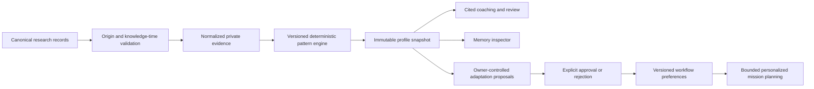

# Phase 11 — Personalized Adaptive Intelligence

MARKET CORTEX now derives local, inspectable research guidance from canonical research records. It distinguishes explicit preferences, observed patterns, evaluated outcomes and unaccepted proposals. Research behavior is not personality, real trading behavior, causal performance or strategy edge.

## Architecture

The modular monolith uses `personal_contracts`, `personal_sources`, `personal_engine`, `personal_store`, `personalization`, `personal_tools`, `personal_missions` and `personal_api`. Migration `0012_personalization.sql` adds append-only record versions and immutable snapshots. Existing PostgreSQL, Parquet, Quant artifacts, prediction/journal stores and Phase 10 orchestration remain authoritative. No vector database, embeddings dependency or always-running learning agent is introduced.

## Origin and data separation

Owner inference requires an explicitly labelled **OWNER_MAIN** environment and a database whose name does not end in `_test`. Canonical journals and predictions must additionally carry `OWNER_RESEARCH` classification. Existing missions, research runs, theses and research-risk snapshots require a typed owner attestation of a real canonical record; raw external text or a model response cannot attest itself. New personalized missions created in an owner environment record this owner action explicitly.

Attestation establishes origin, not a favorable result. Later canonical mission/thesis checkpoints are read only when recorded by the requested cutoff. They do not multiply the entity count. Risk provenance also checks the underlying owner research portfolio and manual position sources. Such portfolios remain research records; **no actual trading habits are inferred**.

`SYNTHETIC_VALIDATION` is a separate namespace permitted only in a labelled `PILOT_TEST` environment with a dedicated `_test` database. Golden fixtures validate behavior without becoming owner history. A test/unknown catalog's owner preview contains zero genuine records and cannot activate owner preferences. Restored owner memories in a test catalog are not treated as currently eligible owner controls.

Real stored Quant evidence is separately labelled `STRATEGY_EVIDENCE`. It may inform a research reminder while owner history is empty; it never counts as owner behavior.

## Memory taxonomy and provenance

| Type | Meaning |
| --- | --- |
| WORKING | Attested active/ready mission checkpoint |
| EPISODIC | Recorded completed research investigation |
| SEMANTIC | Explicit preferences or clearly labelled usage observations |
| PROCEDURAL | Recorded review/invalidation habits and repeated approved tool sequences |
| MARKET | Historical investigation scope, not present market truth |
| STRATEGY | Saved registered quantitative evidence and its limitations |
| FAILURE | Repeated owner-recorded lessons or separate CORTEX omissions/failures |
| PREDICTION | Frozen expectations and then-known outcome evidence |

Memory fields include ID, version, key/type, source type, subject, audience, statement/value, cited evidence, sample count, sufficiency, creation/validation/expiry times, status, algorithm version and owner override. Source types are `EXPLICIT`, `OBSERVED`, `LEARNED_FROM_OUTCOMES`, and `CORTEX_PROPOSED` for unaccepted suggestions. Proposals are kept as their own typed domain and never silently become preferences.

Statuses include ACTIVE, TENTATIVE, OWNER_CONFIRMED, DISABLED, REJECTED, EXPIRED and SUPERSEDED. Inferred habits begin tentative. Recorded singleton episodes are source facts, not recurring habits. A preview memory is marked `persisted=false`; it cannot be corrected or retired until deliberately persisted in an eligible environment. Old versions remain unchanged; history marks earlier versions effectively superseded.

Owner confirmation/rejection/correction/disabling/retirement appends a version with optimistic concurrency checks. Explicit preferences win over inference; the most recent explicit validation/correction wins conflicting explicit values. Rejected, disabled or expired memory does not enter personalized planning. Corrections of preferences use the bounded typed preference schema; corrections of other research memories are owner statements, not learned facts.

## Deterministic rules and sufficiency

Algorithm: **personal_patterns_v1**, with a SHA256 implementation identity captured by the loaded process.

- Zero matching records: INSUFFICIENT_HISTORY.
- One or two matching records: EARLY_PATTERN; no recurring-habit coaching.
- At least three distinct matching research entities: REPEATED_PATTERN.
- At least ten: STRONG_PATTERN, meaning count sufficiency only, not independent statistical confirmation.
- Active pattern window: 90 days. Older evidence remains historical and auditable.
- Compare the most recent ten eligible records with an earlier window of at least three. Falling failure frequency or rising recorded strength frequency is labelled IMPROVING. When improvement is established, the old mistake is not presented as an unchanged current habit.

Revisions/checkpoints do not inflate research-entity counts. Multiple risk computations for one portfolio version count as one research instance. Overlapping predictions/missions and selected samples may still be dependent, and that limitation is disclosed.

Analytics cover instrument/mode/strategy usage, median declared horizon, canonical journal lesson categories, recorded thesis invalidation/opposing evidence/risk completeness, known pre-registered prediction invalidations, approved workflow sequences, research-risk warnings and actual CORTEX omissions/tool failures/rejected grounding/staleness. Missing planned Quant/context evidence is a CORTEX process finding; a factual quick question is not falsely penalized for omitting unplanned Quant. Declared owner reviews and CORTEX-generated evidence are distinguished. Unrecorded clicks, time spent, ignored indicator intent, emotion or personality are not inferred.

Transparent baseline dimensions expose numerator, eligible count and citations. No gamified score or confidence probability is generated. Three consistent feedback observations can request review; one feedback event does not silently change a memory or workflow.

## Coaching, strategy fit and review

Coaching items identify subject (OWNER_PROCESS, CORTEX_PROCESS or STRATEGY_EVIDENCE), record/sample counts and internal citations. Owner-recorded failures are labelled as such. Current patterns, old research facts and suggestions remain separate. No generic praise or unsupported claims about ability are generated.

Usage counts, pre-registered expectation outcomes and temporal OOS evidence remain separate. `behavior_fit` is NOT_ESTABLISHED/INSUFFICIENT_HISTORY unless actual evidence supports something narrower. Personal preference cannot establish strategy edge. The actual saved momentum evidence remains **−7.82%, N=82**: compounded reset-capital folds on selected survivors/dependent trades, not a continuous executable portfolio.

The deterministic review queue ranks recorded prediction due dates/thesis statuses, unresolved missions and research-risk warnings. Study mode exposes original structured expectations/lessons and inspectable answer bases. No invented event urgency appears. Verified event proximity, real trade behavior and unrecorded dashboard actions remain unavailable unless suitable source records exist.

Approved local tools: `personal.profile`, `.mistakes`, `.strengths`, `.strategy_fit`, `.memories`, `.cortex_failures`, `.proposals`, `.timeline`, `.review`. They expose fixed typed read operations, not SQL, filesystem, browser access, code execution or model-generated memory writes. History questions include counts, citations, knowledge scope and explicit unavailable areas. “This month” uses the owner's timezone to restrict behavioral evidence; known historical strategy evidence remains explicitly historical.

## Adaptation and CORTEX integration

Supported preferences are default research horizon (1–60 days), one supported Pilot instrument, bounded research mode, preferred view, and research review emphasis. Detector formulas, strategy definitions, risk limits, holdings, thesis states and canonical Edge Library status are never adapted.

Repeated evidence gaps may create PROPOSED workflow changes. The owner may accept/reject them; accepted changes become explicit preferences. Retirement stops the proposal-linked preference while preserving separate later owner corrections. Owner actions and old versions are retained. Low-risk UI view remembrance is local; there is no automatic activation of important workflow changes.

Personalized planning is a separate optional wrapper over unchanged Phase 10 code. It freezes the profile snapshot/hash/algorithm/knowledge context into the mission before execution. Explicit preferences apply only when the owner requests them and the corresponding mission field was not already explicitly supplied. Approved review emphasis may reorder existing tools only when dependencies, domain/privacy policy and original budgets remain valid. It cannot add an unapproved domain or change a calculation. The plan records exact affected fields and citations/reminders; absence of sufficient history yields no fabricated personal adaptation.

Phase 10 implementation hashes and six accepted pilot dossiers remain identical. Personalized replay checks both deterministic market outputs and original personal source evidence. Frozen snapshots survive later corrections/retirements. Unknown personalization implementations are explicitly identified; old data are not reinterpreted silently. Post-research review reports which planned evidence/contradictions were actually examined, without inventing subsequent outcomes or improvement.

## Snapshots and historical profiles

Snapshots contain knowledge cutoff, algorithm/code identity, normalized evidence, exact memory versions, observations, patterns, proposals, coaching, baseline, review/study items and limitations. Payloads are SHA256 sealed; reads detect corrupted record/snapshot content. Historical reconstruction reads journal/prediction revisions, attested mission/thesis checkpoints, evaluations and Quant recording times known then. Future outcomes, corrections and proposals cannot alter that reconstruction. A newly computed historical view is labelled RETROSPECTIVE_RECONSTRUCTION under its declared algorithm; an originally saved snapshot remains unchanged.

## API, CLI and owner visibility

Typed local prefix `/api/v1/personalization` covers profile, refresh, snapshots, memory search/inspection/history/actions, explicit preferences, proposals/actions, feedback, attestations, questions, registered personal tools, metadata export and personalized mission create/replay/post-review. Historical refresh/write actions are blocked. The workstation proxy uses explicit GET/POST allowlists and loopback checks.

CLI commands: `personal-profile`, `personal-memories`, `personal-proposals`, `personal-timeline`, `personal-export` with `--audience`/`--as-of`; typed JSON workflows `personal-preference`, `personal-memory-action`, `personal-proposal-action`, `personal-feedback`, `personal-attest`, `personal-query`, `personal-mission` use `--input`. Memory/proposal actions also require record ID. Reuse the existing migrate/serve commands and intended environment configuration; keep credentials exclusively in environment variables.

My Research displays history sufficiency, habits/learning, owner versus CORTEX coaching, strategy evidence, review/study items, timeline, explicit preferences, proposals, memory search/type/status filters, citations/source metadata, revisions/corrections and personalized research plans/replay. Owner writes are disabled in a pilot preview. Synthetic mode is explicitly labelled and never presented as real owner learning. Private/source text is React-escaped.

## Privacy and security

Personalization is LOCAL_ONLY and deterministic. Private memory cannot enter a cloud model context even when a broader future cloud preference is enabled. The optional local-context helper exposes only already grounded metadata. No LLM creates memories, canonical values or proposals from arbitrary prose. Raw journal notes, portfolio values, credentials and source instructions are excluded from normalized evidence. Metadata exports omit raw facts and free-text memory/proposal prose. Logs expose policy codes, not connection exceptions or private content. Existing encrypted PostgreSQL/Parquet backup tooling includes the new local tables.

No model, paid service, embeddings system or software runtime was installed for this phase. No order/trading/transfer capability was introduced. Upstox/Alpaca live authenticated validation remains DEFERRED_NOT_CONFIGURED.

## Actual evidence and limitations

The execution session has no owner database connection configured. Actual owner history is therefore unavailable, not assumed empty in the owner's main database. The existing dedicated pilot is not adopted as owner behavior: the validated owner preview has **N=0 / INSUFFICIENT_HISTORY**, no owner mistakes/strengths or active adaptation proposals. Its one generic counter-evidence reminder comes from the actual saved Phase 8 study. The real stored-data personal mission completes INCONCLUSIVE and verifies both market and frozen personal source replay.

Synthetic fixtures separately prove recurrence, strengths, improvement, preferences/overrides, proposal approval, privacy, poisoning protection and personalized tool order. No fixture is claimed as a genuine owner habit. See `PHASE_11_PILOT_RESULTS.json` and the Phase 11 exit matrix for final validation. Phase 12 development has not started.
